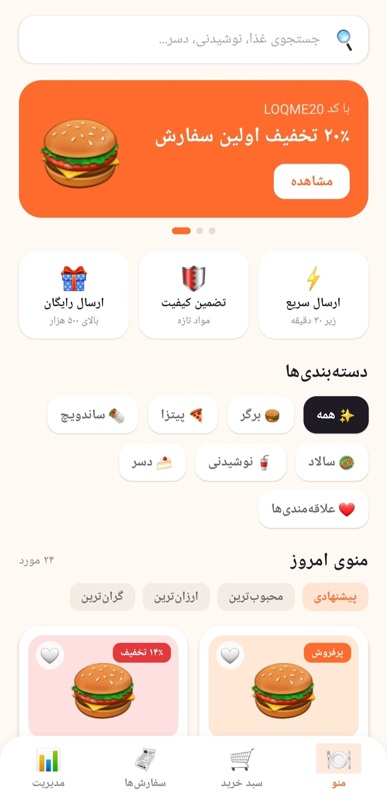
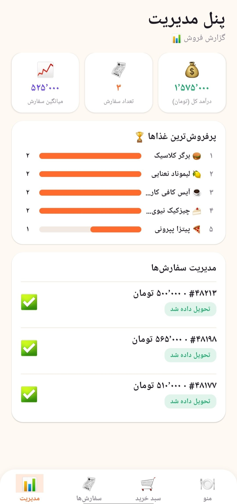

<div align="center">

# 🍔 لقمه | Loqme

**اپلیکیشن سفارش غذا برای اندروید**
**Food Ordering App for Android**


[🇮🇷 فارسی](#-فارسی) | [🇬🇧 English](#-english)

</div>

---

<a name="-فارسی"></a>
# 🇮🇷 فارسی

## 📖 درباره پروژه

**لقمه** یک اپلیکیشن موبایل برای سفارش آنلاین غذا است که برای گوشی‌های اندرویدی ساخته شده است. کاربر می‌تواند غذاها را ببیند، انتخاب کند و سفارش خود را ثبت کند.

این پروژه با **React Native (Expo)** نوشته شده و از **Firebase** به عنوان بک‌اند استفاده می‌کند.

## 📸 تصاویر برنامه

<p align="center">
  
  
</p>

## 🛠 تکنولوژی‌های استفاده شده

- **React Native** با **Expo**
- **JavaScript**
- **Firebase** (پایگاه داده و بک‌اند)

## 📁 ساختار پروژه

```
Loqme-MobileAPP/
├── assets/            # تصاویر و فایل‌های گرافیکی
├── components/        # کامپوننت‌های برنامه
├── App.js             # کامپوننت اصلی برنامه
├── index.js           # نقطه شروع برنامه
├── firebase.js        # تنظیمات اتصال به Firebase
├── app.json           # تنظیمات Expo
├── package.json       # وابستگی‌های پروژه
├── application.apk    # فایل نصبی برنامه (اندروید)
└── README.md          # توضیحات پروژه
```

## 📲 نصب برنامه روی گوشی (ساده‌ترین روش)

1. فایل **`application.apk`** را از همین ریپو دانلود کنید.
2. فایل را روی گوشی اندرویدی خود کپی کنید.
3. روی فایل بزنید تا نصب شود.
4. اگر گوشی پیام داد، گزینه **«نصب از منابع ناشناس»** را فعال کنید.
5. برنامه **لقمه** را باز کنید و استفاده کنید. 🎉

## 💻 اجرای پروژه روی کامپیوتر (برای توسعه‌دهندگان)

**پیش‌نیازها:** نصب [Node.js](https://nodejs.org) و [Expo Go](https://expo.dev/go) روی گوشی.

```bash
# 1. دریافت پروژه
git clone https://github.com/ArianGhaderi99/Loqme-MobileAPP.git

# 2. ورود به پوشه پروژه
cd Loqme-MobileAPP

# 3. نصب وابستگی‌ها
npm install

# 4. اجرای برنامه
npx expo start
```

سپس QR Code نمایش داده شده را با برنامه **Expo Go** اسکن کنید.

## 🔥 تنظیم Firebase

برای اجرای پروژه با بک‌اند خودتان:

1. در [Firebase Console](https://console.firebase.google.com) یک پروژه جدید بسازید.
2. اطلاعات پروژه خود را در فایل `firebase.js` قرار دهید.

## 👤 سازنده

**آرین قادری**
GitHub: [@ArianGhaderi99](https://github.com/ArianGhaderi99)

---

<a name="-english"></a>
# 🇬🇧 English

## 📖 About

**Loqme** (لقمه) is a mobile food ordering app built for Android devices. Users can browse food items, choose what they like, and place their orders.

The project is built with **React Native (Expo)** and uses **Firebase** as its backend.

## 📸 Screenshots

<p align="center">
  
  
</p>

## 🛠 Tech Stack

- **React Native** with **Expo**
- **JavaScript**
- **Firebase** (database and backend)

## 📁 Project Structure

```
Loqme-MobileAPP/
├── assets/            # Images and graphic files
├── components/        # App components
├── App.js             # Main app component
├── index.js           # App entry point
├── firebase.js        # Firebase connection config
├── app.json           # Expo configuration
├── package.json       # Project dependencies
├── application.apk    # Installable Android app file
└── README.md          # Project documentation
```

## 📲 Install on Your Phone (Easiest Way)

1. Download the **`application.apk`** file from this repository.
2. Copy it to your Android phone.
3. Tap the file to install it.
4. If prompted, enable **"Install from unknown sources"**.
5. Open the **Loqme** app and enjoy! 🎉

## 💻 Run the Project Locally (For Developers)

**Requirements:** [Node.js](https://nodejs.org) installed, and the [Expo Go](https://expo.dev/go) app on your phone.

```bash
# 1. Clone the project
git clone https://github.com/ArianGhaderi99/Loqme-MobileAPP.git

# 2. Go to the project folder
cd Loqme-MobileAPP

# 3. Install dependencies
npm install

# 4. Start the app
npx expo start
```

Then scan the QR code with the **Expo Go** app.

## 🔥 Firebase Setup

To run the project with your own backend:

1. Create a new project in the [Firebase Console](https://console.firebase.google.com).
2. Put your project's config in the `firebase.js` file.

## 👤 Author

**Arian Ghaderi**
GitHub: [@ArianGhaderi99](https://github.com/ArianGhaderi99)
